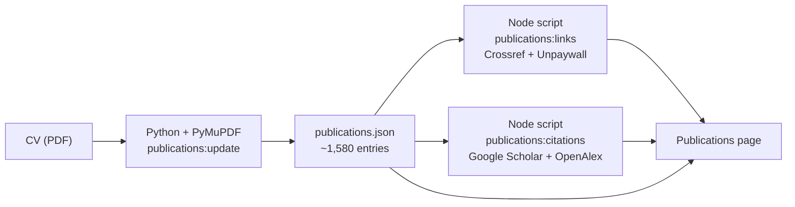

<h1 align="center">Prof. Dr. Ajith Abraham: Portfolio</h1>

<p align="center"><b>Academic portfolio website: research publications with verified links and citation counts, talks, media and a living photo wall, built to be fast, accessible and easy to keep current.</b></p>

<p align="center">
  
  
  
  
  
  
  
  
</p>

<p align="center">
  <a href="https://dr-ajith-abraham-portfolio.vercel.app"><b>Live site</b></a> ·
  <a href="#getting-started">Getting started</a> ·
  <a href="#how-the-publication-data-is-built">Data pipeline</a> ·
  <a href="#design">Design</a>
</p>

---

## Contents

- [Overview](#overview)
- [Features](#features)
- [How the publication data is built](#how-the-publication-data-is-built)
- [Design](#design)
- [Tech stack](#tech-stack)
- [Project structure](#project-structure)
- [Getting started](#getting-started)
- [Maintaining the site](#maintaining-the-site)
- [Deployment](#deployment)
- [About](#about)
- [License](#license)

## Overview

A researcher with more than 1,500 publications is hard to showcase by hand. Lists go stale, links break, citation numbers are copied from memory, and photos from conferences and awards pile up unseen.

This portfolio keeps all of that in one place and keeps it honest. The publication list is generated from the CV. Every link (publisher DOI, free PDF) and citation count is matched against Crossref, Unpaywall, Google Scholar and OpenAlex, and **nothing is guessed**: an uncertain match is left out and queued for a human to review. Around that sits a media page built for impact, with a full-screen drifting wall of moments and milestones, link cards to talks and posts, and a scrollable photo gallery.

## Features

| Area | What it does |
| --- | --- |
| **Publications page** (`#publications`) | Counts by type, publications per year (click a bar to filter), most-cited papers from Google Scholar, and the full list with search, type, year-range and access filters, sorting and pages of 25 |
| **Verified links** | Publisher DOI, free PDF or "free to read" shown only when a confident match exists |
| **Citation counts** | Google Scholar first, OpenAlex as fallback, with the source shown next to each count |
| **Media page** ("Moments & Milestones") | Full-screen drifting photo wall, "Watch & Follow" cards (YouTube, LinkedIn) and a snap-scroll gallery strip |
| **Author PDFs** | Papers can be hosted directly, but only with a recorded sharing permission |
| **Responsive and accessible** | Desktop and phone layouts, keyboard friendly, reduced-motion support |

## How the publication data is built

The CV is the single source of truth. A short pipeline turns it into the data the Publications page shows.



**Python has one job here: turning the CV into data.** A Python step using [PyMuPDF](https://pymupdf.readthedocs.io) reads the publication list from `public/Ajith-Abraham-CV.pdf` and writes `src/data/publications.json`. Everything after that, including links, citations and the website itself, is JavaScript/TypeScript and Node.js.

### Which link appears on an entry

| Link | Shown when | Comes from |
| --- | --- | --- |
| Publisher page (DOI) | Crossref has a record that confidently matches: same title (or the same journal plus page numbers when the CV words the title differently), year, and Prof. Abraham as author or editor | `npm run publications:links` |
| Free PDF | Unpaywall lists a legal open-access copy and the file was downloaded and checked to be a PDF | `npm run publications:links` |
| Free to read | The paper is open access on a web page, but no checkable PDF file was found | `npm run publications:links` |
| Download PDF | The file is in `public/papers/` and listed, with the permission to share it, in `src/data/local-papers.json` | you |

Every entry in the CV list is always shown, with or without links.

## Design

A clean, calm look: a deep navy canvas, white type and soft, rounded glass-style cards. The details below come from the media page.

| | |
| --- | --- |
| **Colour** | Navy `#24476B` background and wall overlay, white text (`rgba(255,255,255,.85)` for descriptions), translucent white cards with a thin border, solid white call-to-action pills with navy text |
| **Typography** | Plus Jakarta Sans, falling back to Inter and then the system UI font. Semibold headings with tight letter-spacing and fluid `clamp()` sizes, light italic hero subtitle |
| **Hero wall** | Full-viewport (`100svh`) photo wall, 6 columns on desktop and 1 on phones. Columns drift at slightly different speeds, edges fade with a mask, and a soft navy gradient keeps the title readable |
| **Watch & Follow** | 3 cards in a row on desktop (stacked under 860px), 28px rounded corners, brand icon badge, short description and a white pill button |
| **Gallery strip** | Horizontal snap scroll, 18px rounded frames, thin border and soft shadow. Frame width follows each photo's aspect ratio so nothing is cropped |
| **Motion** | Hovered or focused wall tile enlarges (about 1.16x) while the rest stay dimmed. Cards fade in on scroll and glow on hover. Gallery photos zoom gently. `prefers-reduced-motion` turns animations off |
| **Responsive** | Under 640px: one wall column, larger title, smaller gallery frames. Under 860px: cards stack. Desktop tile size is calculated so exactly 4 columns fit the visible wall |
| **Accessibility** | Focusable tiles with a visible ring, `aria-label`s on buttons, decorative icons hidden from screen readers, alt text on every photo, dark gradient behind the hero text for contrast |

## Tech stack

| Layer | Tools |
| --- | --- |
| Front end | [React](https://react.dev), TypeScript, [Vite](https://vite.dev) |
| Styling | Plain CSS, inlined in the components |
| Data scripts | Node.js (links, citations, PDF checks, tests) |
| CV parsing | Python with [PyMuPDF](https://pymupdf.readthedocs.io) |
| Data sources | Crossref, Unpaywall, Google Scholar (via [SerpAPI](https://serpapi.com)), [OpenAlex](https://openalex.org) |
| Quality | ESLint with `typescript-eslint` |
| Hosting | [Vercel](https://vercel.com) |

## Project structure

```
components/        Shared components
public/            Static files: CV PDF, wall photos (public/wall/), author PDFs (public/papers/)
scripts/           Node scripts: publication links, citations, PDF checks, tests
src/               App source: components (publications page, media page, DriftWall ...) and data (src/data/*.json)
index.html         Vite entry
vite.config.ts     Vite config
eslint.config.js   ESLint config
tsconfig*.json     TypeScript configs
```

## Getting started

```bash
git clone https://github.com/HarshitaShibe/Prof.-Dr.-Ajith-Abraham-Portfolio.git
cd Prof.-Dr.-Ajith-Abraham-Portfolio
npm install
npm run dev        # start the dev server
npm run build      # production build
```

`scripts/check-local-papers.mjs` runs automatically before every `dev` and `build`.

### Commands

| Command | What it does |
| --- | --- |
| `npm run dev` | Start the Vite dev server |
| `npm run build` | Production build |
| `npm run publications:update` | Rebuild `publications.json` from the CV (needs `pip install pymupdf`) |
| `npm run publications:links you@example.org` | Find DOI and open-access links (Crossref and Unpaywall) |
| `npm run publications:citations you@example.org` | Fetch citation counts (needs API keys, see below) |
| `npm run test:scripts` | Test the link and citation matching and the PDF check (no network needed) |

## Maintaining the site

### Update the CV

1. Replace `public/Ajith-Abraham-CV.pdf`.
2. Run `pip install pymupdf`, then `npm run publications:update`.
3. Re-run `publications:links` and `publications:citations` to refresh links and counts.

### Refresh links

```bash
npm run publications:links you@example.org
```

Crossref and Unpaywall are free; Unpaywall requires an email address. The first run takes roughly half an hour for 1,580 entries. Answers are cached in `scripts/.cache`, so later runs are quick.

Options go after the address as `name=value`, which works in every shell, PowerShell included: `limit=30` for a trial run, `only=journal-12,book-3`, or `refresh` to ignore the cache. In PowerShell, `npm run … -- --email …` does not work because PowerShell drops the `--`. Running `node scripts/enrich-publications.mjs --email you@example.org` also works.

- `src/data/publication-links.json`: the result, read by the page.
- `scripts/output/publication-links-review.csv`: near misses that were not linked, for a person to check. To confirm one, add it to `src/data/publication-links.overrides.json` (`"journal-494": { "doi": "10.1109/tevc.2008.2009457" }`) and run again. To remove a wrong link use `{ "doi": null }`; to hide an open-access link use `{ "oa": null }`.

<details>
<summary><b>Refresh citation counts (Google Scholar first, OpenAlex as fallback)</b></summary>

<br>

You need a key for Google Scholar, read through [SerpAPI](https://serpapi.com) (the free plan covers a run of about 16 searches), and optionally a free [OpenAlex key](https://openalex.org/settings/api) for papers missing from the Scholar profile. In PowerShell:

```powershell
$env:SERPAPI_KEY="your-serpapi-key"
$env:OPENALEX_API_KEY="your-openalex-key"
npm run publications:links you@example.org        # first, if not done: DOIs
npm run publications:citations you@example.org    # then: citations
```

Keys set this way last for the PowerShell window. **Never commit them.**

For each CV entry:

1. **Google Scholar**: the article on Prof. Abraham's profile that matches by title and year (and, when the CV words the title differently, by journal and page numbers).
2. **OpenAlex**, only for entries not on the profile: by DOI first, then title, year and author.
3. **No guessing**: an entry with no match, with several equally good matches, or whose article was also matched by another CV entry gets no count, and is listed in `scripts/output/citations-review.csv` with the candidates and the reason.

The page shows each count with its source and links to the paper there. Counts of zero are not shown, and "Most cited first" sorts by them. The same run refreshes the "Most cited" box (`src/data/scholar-top.json`, the 20 most-cited papers with the date they were retrieved). Saved answers expire after 7 days, so a later run brings fresh counts.

Fix an entry by hand in `src/data/publication-links.overrides.json`: `"scholar": "i95DGLQAAAAJ:…"` (the `citation_for_view` value of its Scholar page) or `"scholar": null`, and `"openalex": "W…"` or `"openalex": null`.

</details>

<details>
<summary><b>Add an author PDF</b></summary>

<br>

1. Check that sharing is allowed: most publishers let authors post the accepted manuscript on a personal website, with conditions that differ by publisher and sometimes an embargo. Jisc's publisher-policy database (formerly Sherpa Romeo) lists them. Open-access articles under CC BY can be shared as published.
2. Put the file in `public/papers/`, named after the entry's id (for example `journal-203.pdf`).
3. Add it to `src/data/local-papers.json` with `version` (`published`, `accepted` or `submitted`) and `permission` (what allows sharing).

`scripts/check-local-papers.mjs` runs before every `dev` and `build`. It offers a PDF only when it is both listed and present, and it stops the build if a PDF in `public/papers/` is not listed, because everything in `public/` is published.

</details>

<details>
<summary><b>Change the media page photos</b></summary>

<br>

Photos live in `public/wall/`, named with consecutive numbers: `1.jpg`, `2.jpg` ... `N.jpg`. When you add or remove photos, update the counts so nothing shows up broken:

| File | Setting | What it controls |
| --- | --- | --- |
| media page (`mediapage.tsx`) | `TOTAL_PHOTOS` | How many photos the bottom gallery strip shows |
| `driftwall.tsx` | `PHOTO_COUNT` | How many photos the wall can pick from |
| `driftwall.tsx` | `TILE_COUNT` | Total tiles on the wall (keep it a multiple of 6 so the desktop columns stay even) |

Currently there are **141** photos. The wall shows the first `TILE_COUNT` of them and the gallery strip shows all of them. Compressing the photos (about 1600px on the long side is plenty) makes the page load much faster.

Other media page settings: edit the `LINKS` array in `mediapage.tsx` for the YouTube and LinkedIn cards, and the props passed to `<DriftWall />` for wall speed, columns and tile size.

</details>

## Deployment

The site is deployed on Vercel at https://dr-ajith-abraham-portfolio.vercel.app. Pushing to `main` redeploys it.

## About

This portfolio was designed and developed during my tenure as a **Software Developer at Greenbit Solutions**, and delivered as a product for Prof. Dr. Ajith Abraham. It covers the full build: visual design, front-end development and the data pipeline behind the publications page.

## License

All content and photos belong to Prof. Dr. Ajith Abraham.