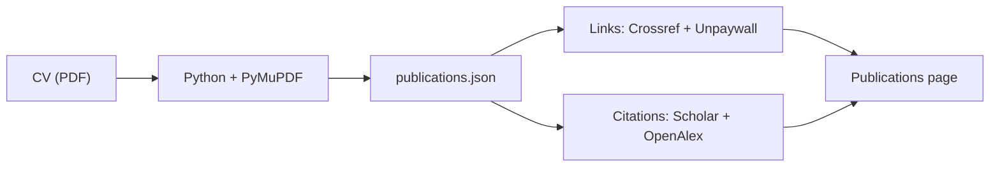

<h1 align="center">Prof. Dr. Ajith Abraham: Portfolio</h1>

<p align="center"><b>Academic portfolio with verified publication links, citation counts, media wall and gallery.</b></p>

<p align="center">
  
  
  
  
  
  
</p>

<p align="center"><a href="https://dr-ajith-abraham-portfolio.vercel.app"><b>Live site</b></a></p>

---

## Overview

A researcher with 1,500+ publications is hard to showcase by hand. This site builds the publication list from the CV, verifies every link and citation count against Crossref, Unpaywall, Google Scholar and OpenAlex, and never guesses. Uncertain matches are left out for review.

## Pages

Career & Leadership · Research · Entrepreneurship · **Publications** · Journals and Publishers · **Most Cited** · **Media & Gallery**

- **Publications:** search, type/year/access filters, sorting and charts, with verified DOI, free PDF and citation counts
- **Most Cited:** top papers by Google Scholar citations
- **Media & Gallery:** drifting photo wall, Watch & Follow cards and a gallery strip

## Features

- **Verified links and citations**: shown only on confident matches, never guessed
- **Responsive and accessible**: phone and desktop, keyboard friendly, reduced-motion support

## Data flow



## Tech stack

React · TypeScript · Vite · Node.js · Python (PyMuPDF) · Vercel

## Project structure

```
components/   Shared components
public/       CV PDF, wall photos (wall/), author PDFs (papers/)
scripts/      Node scripts: links, citations, PDF checks, tests
src/          Pages, components and data (src/data/*.json)
```

## Getting started

```bash
git clone https://github.com/HarshitaShibe/Prof.-Dr.-Ajith-Abraham-Portfolio.git
cd Prof.-Dr.-Ajith-Abraham-Portfolio
npm install
npm run dev
```

| Command | Purpose |
| --- | --- |
| `npm run build` | Production build |
| `npm run publications:update` | Rebuild `publications.json` from the CV (`pip install pymupdf`) |
| `npm run publications:links you@example.org` | Fetch DOI and open-access links |
| `npm run publications:citations you@example.org` | Fetch citation counts (needs `SERPAPI_KEY`) |
| `npm run test:scripts` | Run script tests |

## Updating content

- **CV:** replace `public/Ajith-Abraham-CV.pdf`, then run the three `publications:*` commands.
- **Photos:** add `N.jpg` to `public/wall/`, then set `TOTAL_PHOTOS` (media page) and `PHOTO_COUNT` (`driftwall.tsx`) to `N`. Currently 141.
- **Author PDFs:** add the file to `public/papers/` and list it with its sharing permission in `src/data/local-papers.json`.

Never commit API keys.

## About

Designed and developed during my tenure as a **Software Developer at Greenbit Solutions**, delivered as a product for Prof. Dr. Ajith Abraham.

## License

All content and photos belong to Prof. Dr. Ajith Abraham.